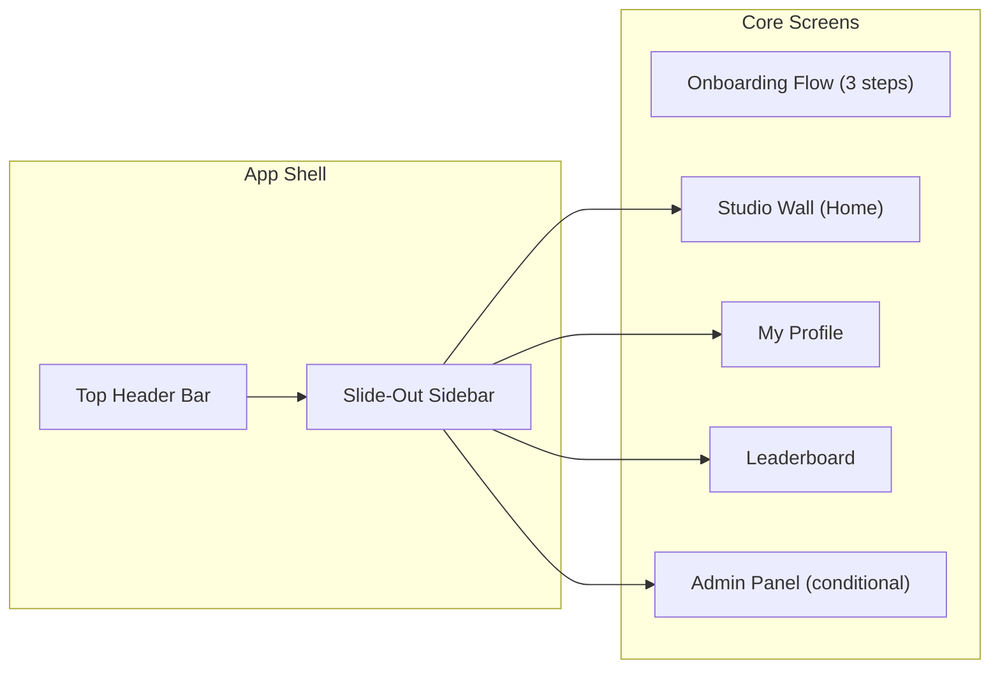
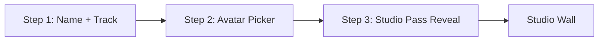
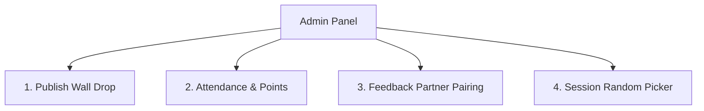
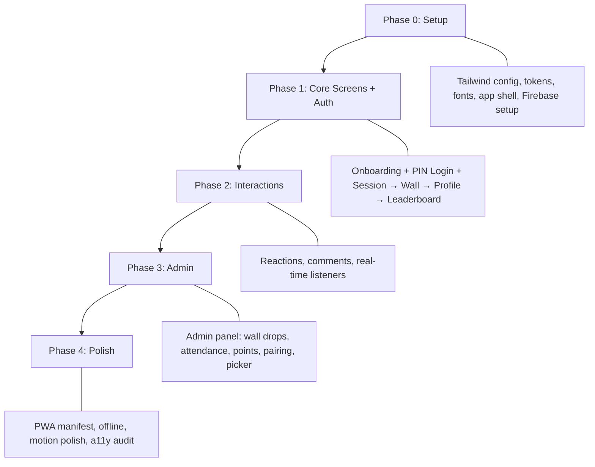

# Enactus AU — UI/UX Design & Implementation Plan

> [!IMPORTANT]
> This plan synthesizes the existing **DESIGN.md** (SayBriefly style reference), the **PRD**, and research from **ui-ux-pro-max** and **design** skills into an actionable, screen-by-screen build roadmap.

---

## 1. Design System Foundation

### 1.1 Visual Identity: SayBriefly Sketchbook Aesthetic

The app's identity is **already defined** in [DESIGN.md](file:///d:/Course/Projects/Enactusyy/DESIGN.md). This is the single source of truth — no deviation.

| Axis | Decision | Rationale |
|------|----------|-----------|
| **Canvas** | Cream Paper `#fcfaf5` — never `#fff` | Warm studio-on-paper feel |
| **Ink** | Forest Ink `#1a3300` — never `#000` | Sole chromatic authority for text, borders, CTAs |
| **Highlight** | `#ffe95c` — marker wash only, never CTA fill | PINs, keyword highlights, point pills |
| **Accents** | Mint `#d5f5c2`, Teal `#a8e5e5`, Blush `#f6d0ff` | Sticky-note cards — generally one pastel per row. **Exceptions:** Profile Row 2 (Mint Streak + Blush Tier side-by-side) and Leaderboard Podium (3 pastel cards) are intentional paired layouts where each card has distinct content and a 16px gap provides visual breathing room |
| **Alert** | Terracotta `#cb5521` | Deadlines and missed-streak warnings only |
| **Hierarchy** | Color fills + 1px borders, not shadows | Flat tactile, no drop-shadows above 2px blur |

### 1.2 Typography Mapping

| Role | Family | Weight | Size | Tracking |
|------|--------|--------|------|----------|
| Display headlines (≥32px) | Bricolage Grotesque | 800 | 32–90px | 0.04–0.05em |
| UI / body / buttons / headings | Inter | 400–700 | 14–40px | normal |
| PINs / ranks / points / metadata | Roboto Mono | 400 | 12–16px | normal |

**Strict rule:** Bricolage Grotesque is NEVER used below 32px or for body/nav/buttons.

### 1.3 Shape & Spacing Tokens

| Token | Value | Used For |
|-------|-------|----------|
| `--radius-buttons` | 6px | All buttons, tags |
| `--radius-cards` | 12px | Content cards, wall posts |
| `--radius-nav` | 16px | Floating containers, sidebar |
| `--radius-full` | 9999px | Avatars, filter pills |
| `--spacing-unit` | 8px | Base unit for all spacing |
| `--page-max-width` | 480px mobile / 768px admin desktop | Mobile-first PWA |

### 1.4 Tailwind v4 Integration

The [DESIGN.md `@theme` block](file:///d:/Course/Projects/Enactusyy/DESIGN.md#L352-L419) provides ready-to-paste Tailwind v4 tokens. Implementation steps:
1. Copy the `@theme { ... }` block into the project's main CSS file
2. Add Google Fonts import for Bricolage Grotesque, Inter, and Roboto Mono
3. Configure `max-width: 480px` centered phone container for member views

---

## 2. Screen Architecture & Navigation

### 2.1 App Shell & Navigation Model



**Navigation Pattern:** Hamburger → Slide-out sidebar drawer (left), not bottom tab bar.

| Element | Spec |
|---------|------|
| **Top Header** | Sticky, `#fcfaf5`, 1px `#b6b6b6` bottom border. Left: ☰ hamburger. Center: "Enactus Studio". Right: circular avatar → My Profile |
| **Sidebar** | Slides from left over backdrop overlay. `#fcfaf5` surface, 1px `#1a3300` right border. Active link: Teal `#a8e5e5` fill + 1px `#1a3300` border, 6px radius |
| **Sidebar Header** | Mini-card: Avatar + Name + Track tag + `#PIN` (Roboto Mono) |
| **Sidebar Footer** | Log Out button (clears localStorage, returns to onboarding) |

> [!TIP]
> **UX Guideline (Navigation > Back Button, Severity: High):** Preserve navigation history with `history.pushState()` — never `location.replace()`. The sidebar must work correctly with the browser back button on mobile PWA.

---

## 3. Screen-by-Screen Specifications

### 3.1 Onboarding Flow (3 Steps, < 45 Seconds)



> [!NOTE]
> **UX Guideline (Onboarding > User Freedom, Severity: Medium):** Provide Skip and Back buttons. Users should be able to navigate between steps freely.
> 
> **UX Guideline (Feedback > Progress Indicators, Severity: Medium):** Show "Step X of 3" indicator at the top of each onboarding screen.

#### Step 1 — Name & Track Selection

| Element | Implementation |
|---------|----------------|
| **Headline** | Bricolage Grotesque 800, ~40px mobile. Highlight keyword in `#ffe95c` wash. Example: *"Join the <mark>Studio</mark>"* |
| **Name Input** | Full-width, `#fcfaf5` background, 1px `#1a3300` border, 12px radius. Regex: `^[A-Za-z\s]+$`. Inline error: *"Please enter your name in English letters only."* |
| **Track Cards** | 2 side-by-side tappable cards. Unselected: `#fcfaf5` + 1px `#b6b6b6` border. Selected: `#a8e5e5` fill + 2px `#1a3300` border |
| **CTA** | Full-width Forest Ink button: `Continue →`. Disabled (opacity 0.5) until valid name + track selected |
| **Login Link** | Below CTA: *"Already have a PIN? Log in →"* — opens modal with Name + 4-digit PIN fields |

**UX Notes:**
- Use `inputmode="text"` and `autocomplete="name"` for the name input
- Track cards need `aria-pressed` or radio-group semantics for screen readers
- Minimum 2 characters for name validation
- Real-time validation feedback (not on submit)

> [!IMPORTANT]
> **PIN Login Auth Logic:** Since `pinCode` is unique in Firestore, authenticate by querying `users` where `pinCode == enteredPin` (primary key lookup). Optionally verify `nameLower === enteredName.trim().toLowerCase()` as a secondary check. This avoids collisions when members share similar names or type different casing. Never query by name alone.

#### Step 2 — Visual Avatar Picker

| Element | Implementation |
|---------|----------------|
| **Header** | Bricolage Grotesque: *"Hi <mark>[First Name]</mark>, pick your avatar!"* |
| **Avatar Grid** | 12–16 avatars in a 3-column grid (mobile) or 4-column. Each avatar: 72–80px circular image |
| **Selection State** | Selected: Mint `#d5f5c2` border highlight + 2px `#1a3300` border |
| **CTA** | `Confirm Avatar →` (enabled when avatar selected) |

**Strict rule:** Display ONLY visual artwork — no character names, lore, or stats.

#### Step 3 — Studio Pass Card Reveal

| Element | Implementation |
|---------|----------------|
| **Loading State** | 2-second animation with sketch doodle + *"Generating your Studio Pass..."* text. Skeleton pulse. Backend creates user record + assigns unique 4-digit PIN |
| **Pass Card** | Scrapbook-style ID card on `#fcfaf5` with 2px `#1a3300` border. Contains: Avatar, Full Name, Track Badge, 4-Digit PIN in Roboto Mono on `#ffe95c` block |
| **Microcopy** | *"Save this 4-digit code—you'll need it if you log in from another device."* |
| **CTA** | `Enter the Studio →` — persists session in `localStorage`, navigates to Studio Wall |

> [!WARNING]
> **PIN Generation:** Must be unique, random, zero-padded (`0000–9999`). Check for uniqueness against the database before assignment. The PIN field uses `inputmode="numeric"` on login.

---

### 3.2 Studio Wall (Home Screen)

The central hub — coordinator updates + community posts.

#### Layout Structure

```
┌──────────────────────────────┐
│ ☰   Enactus Studio      (•) │  ← Sticky header
├──────────────────────────────┤
│ [All] [Admin Drops] [Community] │  ← Filter pills (9999px radius)
├──────────────────────────────┤
│ ┌──────────────────────────┐ │
│ │ Share an idea...    Post→│ │  ← Post composer card
│ │ Add a link...            │ │
│ └──────────────────────────┘ │
├──────────────────────────────┤
│ ┌── 📌 ANNOUNCEMENT ──────┐ │  ← Pinned admin drop (Mint card)
│ │ [Mint #d5f5c2 card]      │ │
│ │ Title / Body / Link / TS │ │
│ └──────────────────────────┘ │
├──────────────────────────────┤
│ ┌──────────────────────────┐ │  ← Member wall card (Cream)
│ │ (•) Name · Design · 2h  │ │
│ │ Post body text...        │ │
│ │ 🔥 3  💡 1  ❤️ 5  💬 2  │ │
│ └──────────────────────────┘ │
└──────────────────────────────┘
```

#### Component Specifications

| Component | Surface | Border | Details |
|-----------|---------|--------|---------|
| **Filter Pills** | Active: `#1a3300` fill, `#fcfaf5` text. Inactive: `#fcfaf5` fill, 1px `#b6b6b6` border | 9999px radius | Horizontal scroll on overflow |
| **Post Composer** | `#fcfaf5` | 1px `#1a3300` | Placeholder text, optional link input, `Post →` button |
| **Admin Drop (Announcement)** | `#d5f5c2` or `#ffe95c` | 1px `#1a3300` | Top pill badge in Roboto Mono: `📌 ANNOUNCEMENT`, `⚡ TASK`, or `🔗 RESOURCE`. Pinned to top |
| **Member Post Card** | `#fcfaf5` | 1px `#b6b6b6`, 12px radius | Avatar, name, track badge, timestamp. Body text. Reaction pills + comment thread |
| **Reaction Pills** | `#fcfaf5` | 1px `#b6b6b6`, 9999px radius | Toggleable: 🔥 💡 ❤️ with live counts. Active state: `#ffe95c` fill |

> [!TIP]
> **UX Guideline (Responsive > Table Handling, Severity: Medium):** On admin drops with links, use horizontal scroll wrapper. For the feed, use card layout (already done) rather than tables.
> 
> **UX Guideline (Touch > Pull to Refresh, Severity: Low):** Use `overscroll-behavior: contain` to prevent accidental pull-to-refresh on the feed scroll.

---

### 3.3 Member Profile (Card Grid Layout)

Structured, breathable card grid with 16px gaps between all cards.

```
┌──────────────────────────────┐
│          IDENTITY CARD        │  Card 1
│    ┌───┐                      │
│    │ 🎨│  Yousef Ehab          │
│    └───┘  [Design]  ID #4829  │
│           (Roboto Mono on     │
│            #ffe95c wash)      │
└──────────────────────────────┘
         ↕ 16px gap
┌─────────────┐ ┌──────────────┐
│ 🔥 STREAK   │ │ 💎 TIER      │  Card Row 2
│ Mint card    │ │ Blush card   │
│ 4 Sessions   │ │ Mythic       │
│ Best: 5      │ │ ████████░ 92%│
└─────────────┘ └──────────────┘
         ↕ 16px gap
┌──────────────────────────────┐
│       RANKINGS OVERVIEW       │  Card 3
│    #4 Overall  │  #2 Design   │
│    (Roboto Mono divider)      │
└──────────────────────────────┘
         ↕ 16px gap
┌──────────────────────────────┐
│    FEEDBACK PARTNER (Teal)    │  Card 4
│    (•) Partner Name [Content] │
└──────────────────────────────┘
```

#### Card Specifications

| Card | Surface | Content |
|------|---------|---------|
| **1 — Identity** | `#fcfaf5` + 1px `#1a3300` | Avatar (72–80px circle), Name (Inter 700, 22px), Track pill, ID badge (Roboto Mono on `#ffe95c`) |
| **2L — Streak** | Mint `#d5f5c2` | 🔥 icon + count (Roboto Mono), "Attendance Streak" label, best-streak note |
| **2R — Tier** | Blush `#f6d0ff` | Tier emoji + title, progress bar to next tier |
| **3 — Rankings** | `#fcfaf5` + 1px `#1a3300` | Two columns with 1px `#b6b6b6` vertical divider. Ranks in Roboto Mono |
| **4 — Feedback Partner** | Teal `#a8e5e5` + 1px `#1a3300` | "FEEDBACK PARTNER" (Roboto Mono), partner avatar + name + track. Empty state: *"Your feedback partner will be paired soon!"* |

#### Tier Progression System

| Tier | Points | Emoji |
|------|--------|-------|
| Potato | 0–49 | 🥔 |
| Rookie | 50–149 | 🐣 |
| Pro | 150–299 | ⚡ |
| Legend | 300–499 | 🚀 |
| Mythic | 500+ | 💎 |

> [!NOTE]
> **Progress Bar:** Displays percentage toward next tier. At Mythic (500+), show full bar with glow effect. The progress bar fill color should match the tier's accent: Mint for Potato/Rookie, `#ffe95c` for Pro, Teal for Legend, Blush for Mythic.

---

### 3.4 Leaderboard Screen

```
┌──────────────────────────────┐
│ [All SM] [Design] [Content]   │  ← Filter tabs
├──────────────────────────────┤
│ ┌────┐ ┌────────┐ ┌────┐    │
│ │ #2 │ │  #1    │ │ #3 │    │  ← Podium (Teal, Mint, Blush)
│ │Teal│ │ Mint   │ │Blush│   │
│ └────┘ └────────┘ └────┘    │
├──────────────────────────────┤
│ #4  (•) Name [Design] ⚡ 280 │  ← Ranked list
│ #5  (•) Name [Content] 🐣 120│
│ ► #6  (•) YOU [Design] 🐣 95 │  ← Highlighted current user
│ #7  (•) Name [Content] 🥔 40 │
└──────────────────────────────┘
```

| Component | Spec |
|-----------|------|
| **Top 3 Podium** | 3 distinct sticky-note cards: #1 Mint (tallest/center), #2 Teal (left), #3 Blush (right). Each shows rank (Roboto Mono), avatar, name, tier emoji, points |
| **Ranked List** | Clean rows: Rank (Roboto Mono) + Avatar + Name + Track pill + Tier emoji + Points (on `#ffe95c` wash). Current user row: 2px `#1a3300` border + subtle tint |
| **Filter Tabs** | Same pill pattern as Wall filter. `All Social Media` / `Design` / `Content` |

---

### 3.5 Admin Panel (Coordinator Only)

Conditionally rendered when `user.role === 'admin'`. May expand to `max-width: 768px` on desktop for table management.

#### Admin Sections



| Section | Key UI Elements |
|---------|-----------------|
| **1. Wall Drop Publisher** | Type selector (Announcement / Task / Resource), Title input, Body textarea, Link URL input, `Pin to top` toggle, `Publish →` CTA |
| **2. Attendance & Points** | Member checklist with Present/Absent/Excused toggles. Quick Points: multi-select members → preset reason dropdown (+20 Task, +10 Session, +15 Initiative, −10 Missed) or custom amount → `Apply →` |
| **3. Feedback Pairing** | Manual dropdown pairing OR `Auto-Pair All Members` button. Option: prefer cross-track pairs (Design + Content) |
| **4. Random Picker** | Filter: All / Design / Content. Animated roulette reveal with playful animation |

> [!TIP]
> **UX Guideline (Responsive > Table Handling, Severity: Medium):** For the attendance checklist on mobile, use a card-based layout (one member per card with toggle buttons) instead of a table. Wrap in `overflow-x-auto` only if truly tabular on desktop.

---

## 4. Interaction & Motion Guidelines

### 4.1 Motion Principles

| Motion Type | Timing | Easing | Notes |
|-------------|--------|--------|-------|
| **Button press** | 150ms | ease-out | Opacity/scale feedback, no layout shift |
| **Sidebar open/close** | 250ms | ease-in-out | Slide from left + backdrop fade |
| **Card appear** | 200ms | ease-out | Subtle fade-in on scroll, NOT stagger per-card |
| **Studio Pass reveal** | 2000ms total | spring | Playful sketch animation → card slide-up |
| **Random picker** | 1500ms | decelerate | Roulette spin → settle on name |
| **Reaction toggle** | 100ms | ease-out | Scale 1 → 1.15 → 1 bounce |

> [!WARNING]
> **UX Guideline (Animation > Reduced Motion, Severity: High):** ALL motion must check `prefers-reduced-motion`. Under reduced motion: skip animations, show final state immediately, no fade-in delays.
>
> **UX Guideline (Animation > Continuous Animation, Severity: Medium):** Only use continuous animations for loading indicators. The streak flame icon and tier emojis must NOT continuously bounce or animate.

### 4.2 Loading States

- **Feed loading:** Skeleton cards with `animate-pulse` on cream surface
- **Profile loading:** Skeleton card grid matching final layout
- **Leaderboard loading:** Skeleton podium + list rows
- **Button loading:** Spinner replaces arrow glyph, button disabled

---

## 5. Accessibility Checklist

| Requirement | Implementation |
|-------------|----------------|
| **Color contrast** | Forest Ink `#1a3300` on `#fcfaf5` = 13.2:1 ✅. Forest Ink on Mint `#d5f5c2` ≈ 7.5:1 ✅. Verify all pastel surfaces meet 4.5:1 |
| **Keyboard navigation** | Tab order matches visual order. Sidebar trap focus when open. Escape closes sidebar/modals |
| **Screen reader** | Track selection = radio group with `aria-label`. Reactions = toggle buttons with `aria-pressed`. Rank positions announced |
| **Touch targets** | All interactive elements ≥ 44×44px minimum. Avatar thumbnails, reaction pills, filter tabs all meet minimum |
| **Focus indicators** | 2px `#1a3300` outline with 2px offset on all focusable elements |
| **Reduced motion** | `prefers-reduced-motion: reduce` disables all transitions |
| **PWA installability** | `manifest.json` with correct theme color (`#fcfaf5`), icons, `display: standalone` |

---

## 6. Responsive Strategy

| Breakpoint | Layout | Max Width |
|------------|--------|-----------|
| **Mobile (default)** | Single column, full-width cards | 480px centered |
| **Tablet (768px+)** | Admin panel expands, 2-col admin grids | 768px admin |
| **Desktop (1024px+)** | Phone mockup container centered on cream canvas | 480px app + decorative doodles |

**Mobile-first CSS approach:** Default styles target 360px+. Use `min-width` media queries to enhance for larger screens. Never desktop-first.

---

## 7. Tech Stack Decisions

| Layer | Technology | Notes |
|-------|------------|-------|
| **Framework** | React + Vite | PWA-capable, fast HMR |
| **Styling** | Tailwind CSS v4 | Use DESIGN.md `@theme` tokens directly |
| **Backend** | Firebase (Cloud Firestore) | Real-time `onSnapshot` listeners, no SQL migrations |
| **Auth** | Name + 4-digit PIN (custom, localStorage) | Query by unique `pinCode`, verify `nameLower` |
| **PWA** | Workbox / vite-plugin-pwa | Offline shell, installable |
| **Icons** | SVG custom doodles + Phosphor for utility | Never emojis as structural icons — emojis are OK for tier display (🥔🐣⚡🚀💎) and reactions (🔥💡❤️) since those are content, not UI controls |
| **Fonts** | Google Fonts: Bricolage Grotesque, Inter, Roboto Mono | Variable font for Bricolage |

### 7.1 Firestore Collections Structure

| Collection | Document ID | Fields |
|------------|-------------|--------|
| **`users`** | Auto-ID (`uid`) | `name` (string), `nameLower` (string — lowercase for case-insensitive login), `pinCode` (string, unique 4-digit `"0000"–"9999"`), `track` (`"Design"` \| `"Content"`), `avatarId` (string), `role` (`"member"` \| `"admin"`), `points` (number, default `0`), `sessionStreak` (number, default `0`), `bestStreak` (number, default `0`), `feedbackPartnerId` (string \| `null`), `createdAt` (Timestamp) |
| **`wallPosts`** | Auto-ID | `authorId` (string), `authorName` (string — denormalized), `authorAvatarId` (string), `authorTrack` (string), `postType` (`"member_post"` \| `"announcement"` \| `"task"` \| `"resource"`), `title` (string \| `null`), `content` (string), `linkUrl` (string \| `null`), `isPinned` (boolean), `reactions` (map: `{ "🔥": ["userId1"], "💡": [], "❤️": [] }`), `commentCount` (number, default `0`), `createdAt` (Timestamp) |
| **`wallPosts/{postId}/comments`** *(subcollection)* | Auto-ID | `userId` (string), `userName` (string), `userAvatarId` (string), `userTrack` (string), `content` (string), `createdAt` (Timestamp) |
| **`pointEvents`** | Auto-ID | `userId` (string), `amount` (number), `reason` (string), `createdAt` (Timestamp) |
| **`attendance`** | Auto-ID | `sessionTitle` (string), `userId` (string), `status` (`"present"` \| `"absent"` \| `"excused"`), `sessionDate` (string `YYYY-MM-DD`), `createdAt` (Timestamp) |

> [!NOTE]
> **Why denormalize?** Storing `authorName`, `authorAvatarId`, and `reactions` directly on `wallPosts` avoids N+1 reads on mobile. Reactions use `arrayUnion`/`arrayRemove` for atomic toggle operations. The team size (~20–60 members) fits comfortably in a single Firestore snapshot for leaderboard computation.

### 7.2 Key Firebase Implementation Details

| Concern | Implementation |
|---------|----------------|
| **Unique PIN generation** | Generate random zero-padded string: `String(Math.floor(Math.random() * 10000)).padStart(4, '0')`. Query `users` where `pinCode == generatedPin` (`limit(1)`). If exists, retry. If empty, save |
| **Returning member login** | Query `users` where `pinCode == enteredPin`. Optionally verify `nameLower === enteredName.trim().toLowerCase()`. Save user `id` + `pinCode` in `localStorage` (`enactus_studio_session`) |
| **Real-time Wall** | `onSnapshot` on `wallPosts` ordered by `isPinned` (desc), then `createdAt` (desc) |
| **Real-time Leaderboard** | `onSnapshot` on `users` ordered by `points` (desc). Compute overall rank and track rank client-side |
| **Admin seed** | One-time seed utility: creates admin doc (`name: "Yousef Ehab"`, `nameLower: "yousef ehab"`, `pinCode: "1234"`, `track: "Design"`, `role: "admin"`) |

### 7.3 Firestore Security Rules (MVP / Beta)

```javascript
rules_version = '2';
service cloud.firestore {
  match /databases/{database}/documents {
    match /users/{userId} {
      allow read: if true;
      allow create: if request.resource.data.pinCode is string
                    && request.resource.data.pinCode.size() == 4
                    && request.resource.data.role == 'member';
      allow update: if true; // Lock down admin-only fields (role, points, streak) before production
    }

    match /wallPosts/{postId} {
      allow read, create, update: if true;
      allow delete: if true;

      match /comments/{commentId} {
        allow read, create: if true;
      }
    }

    match /pointEvents/{eventId} {
      allow read, create: if true;
    }

    match /attendance/{attId} {
      allow read, create, update: if true;
    }
  }
}
```

> [!WARNING]
> These rules are intentionally permissive for the **beta season MVP**. Before sharing the link publicly, restrict `update` on `users` admin-only fields (`role`, `points`, `sessionStreak`, `bestStreak`) to documents where the requesting user has `role == 'admin'`.

---

## 8. Implementation Priority (Build Order)



| Phase | Screens / Features | Priority |
|-------|-------------------|----------|
| **0 — Foundation** | Tailwind v4 config with DESIGN.md tokens, Google Fonts, app shell (header + sidebar), Firebase config (`src/lib/firebase.ts` with `VITE_FIREBASE_*` env vars), router setup, avatar data (`src/data/avatars.ts`), tier logic (`src/utils/tiers.ts`) | 🔴 Critical |
| **1 — Core Screens + Auth** | Onboarding (3 steps) + PIN Login + `localStorage` session persistence (testable login/logout loop), Studio Wall (feed + composer + filters), My Profile (4-card grid), Leaderboard (podium + list). Admin seed utility | 🔴 Critical |
| **2 — Interactions** | Post reactions (toggle pills with `arrayUnion`/`arrayRemove`), comment threads (subcollection), real-time `onSnapshot` listeners on Wall and Leaderboard | 🟡 High |
| **3 — Admin Panel** | Wall drop publisher, attendance logger, points system (with `pointEvents` audit log), feedback pairing, random picker | 🟡 High |
| **4 — Polish** | PWA manifest + service worker, offline fallback, motion refinements, accessibility audit, `prefers-reduced-motion`, desktop phone-mockup wrapper, security rules hardening | 🟢 Medium |

---

## 9. Component Inventory

Complete list of unique components to build:

| # | Component | Used In | Key Variant |
|---|-----------|---------|-------------|
| 1 | `TopHeader` | App Shell | Sticky, hamburger + title + avatar |
| 2 | `SidebarDrawer` | App Shell | With mini-card, nav links, logout |
| 3 | `BricolageHeadline` | Onboarding, various | With `#ffe95c` marker highlight |
| 4 | `TrackCard` | Onboarding S1, various | Selectable (unselected/selected states) |
| 5 | `AvatarGrid` | Onboarding S2 | 3-col/4-col, selectable |
| 6 | `StudioPassCard` | Onboarding S3 | Scrapbook ID card with PIN |
| 7 | `FilterPills` | Wall, Leaderboard | Scrollable, active/inactive |
| 8 | `PostComposer` | Studio Wall | Input + link + post button |
| 9 | `AdminDropCard` | Studio Wall | Mint/Yellow, type badge, pinnable |
| 10 | `MemberPostCard` | Studio Wall | Avatar, text, reactions, comments |
| 11 | `ReactionPill` | MemberPostCard | Toggleable emoji + count |
| 12 | `CommentThread` | MemberPostCard | Expandable thread |
| 13 | `IdentityCard` | Profile | Avatar + name + track + PIN |
| 14 | `StreakCard` | Profile | Mint, flame + count |
| 15 | `TierCard` | Profile | Blush, emoji + progress bar |
| 16 | `RankingsCard` | Profile | Two-column with divider |
| 17 | `FeedbackPartnerCard` | Profile | Teal, partner info or empty state |
| 18 | `PodiumCards` | Leaderboard | 3 cards: Mint, Teal, Blush |
| 19 | `LeaderboardRow` | Leaderboard | Rank + avatar + name + points |
| 20 | `WallDropForm` | Admin | Type select + title + body + pin toggle |
| 21 | `AttendanceChecklist` | Admin | Member list with status toggles |
| 22 | `QuickPointsForm` | Admin | Multi-select + preset/custom amount |
| 23 | `FeedbackPairer` | Admin | Manual dropdown or auto-pair |
| 24 | `RandomPicker` | Admin | Roulette animation |
| 25 | `PINLoginModal` | Onboarding | Name + 4-digit PIN input |
| 26 | `TrackBadge` | Various | Pill: "Design" or "Content" |
| 27 | `TierBadge` | Various | Emoji + tier name |
| 28 | `SkeletonCard` | Loading states | Pulse animation matching card shapes |

---

## 10. Do's and Don'ts Summary

### ✅ Do

- Use Forest Ink `#1a3300` for ALL text, links, and CTA buttons
- Set display headlines in Bricolage Grotesque 800 with positive tracking
- Apply `#ffe95c` as background wash behind words, not as button fill
- Use 6px radius for buttons, 12px for cards — consistent everywhere
- Separate layers with color fills + 1px borders, never shadows
- Keep 95% cream + forest green; pastels appear as individual card fills only
- Respect `prefers-reduced-motion` on every animation
- Use `inputmode="numeric"` for PIN fields
- Persist navigation history with `history.pushState()`

### ❌ Don't

- Don't use Bricolage Grotesque below 32px or for body/nav/buttons
- Don't introduce a second primary brand color
- Don't apply heavy drop shadows (>2px blur)
- Don't use pure black `#000` for text
- Don't center-align body text wider than 640px
- Don't use `#ffe95c` as a CTA background
- Don't place multiple pastel accent cards in the same row **except** the two designated spots: Profile Row 2 (Mint Streak + Blush Tier) and Leaderboard Podium (Mint #1, Teal #2, Blush #3) — these are intentional paired layouts with 16px gaps for breathing room
- Don't use emojis as structural/navigation icons (emojis are fine for tier/reaction content)
- Don't use `location.replace()` — always preserve back button history
- Don't query by name alone for login — always use `pinCode` as the primary lookup key

---

## 11. Cursor Agent Prompt — Phase 0 + Phase 1

Copy-paste this prompt into Cursor Agent to kick off the build:

> Read our implementation plan (`PLAN.md`) and `DESIGN.md`. We are using **Firebase (Cloud Firestore)** as our backend. Build **Phase 0 + Phase 1**:
>
> 1. **Firebase setup:** Install `firebase` and configure `src/lib/firebase.ts` using `VITE_FIREBASE_*` environment variables (with a clean `.env.example`).
> 2. **Tailwind v4 tokens:** Set up Tailwind CSS v4 with the exact `SayBriefly` tokens from `DESIGN.md` (`#fcfaf5` Cream Paper, `#1a3300` Forest Ink, `#ffe95c` Highlighter Yellow, `#d5f5c2` Mint, `#a8e5e5` Teal, `#f6d0ff` Blush, `#cb5521` Terracotta) and load `Bricolage Grotesque` (800), `Inter` (400–700), and `Roboto Mono` (400) via Google Fonts.
> 3. **Data utilities:** Create `src/data/avatars.ts` with 16 distinct illustrated SVG studio avatars (no character names) and `src/utils/tiers.ts` for the `Potato 🥔 (0–49) → Rookie 🐣 (50–149) → Pro ⚡ (150–299) → Legend 🚀 (300–499) → Mythic 💎 (500+)` progression logic.
> 4. **Onboarding + PIN Login + Session:** Build the complete **3-Step Onboarding Flow + Returning PIN Login** connected to Firestore (`users` collection), including unique 4-digit PIN generation, the 2-second Studio Pass reveal, `localStorage` session persistence, and a seed utility to create the Admin account (`Yousef Ehab`, PIN `1234`, `Design`).
> 5. **PIN login auth:** Query by `pinCode` (unique primary key), optionally verify `nameLower`. Never query by name alone.
>
> Build Phase 0 and Phase 1 cleanly and pause so I can test onboarding and PIN login before moving to the Studio Wall, Profile, and Leaderboard.
